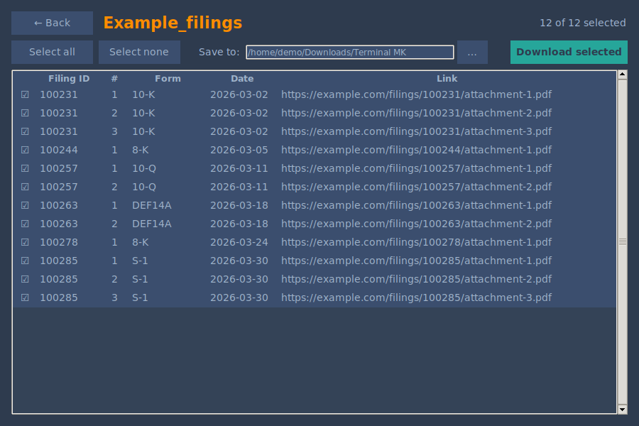

#  Terminal MK - Downloader

Desktop companion for [terminal.mk](https://terminal.mk) that downloads whole batches of filing attachments in one go.

Browsers are bad at downloading hundreds of files at once, so the **Download All** button on the Corporate Filings view hands the batch to this app. You review the list, pick a folder, and it downloads everything in parallel.



## Download

| System | File |
|---|---|
| Windows 10/11 (x64) | [`terminal.mk-dl-gui.exe`](https://github.com/terminal-mk/downloader/releases/latest/download/terminal.mk-dl-gui.exe) |
| macOS, Apple Silicon | [`terminal.mk-dl-macos-arm64.zip`](https://github.com/terminal-mk/downloader/releases/latest/download/terminal.mk-dl-macos-arm64.zip) |
| macOS, Intel | [`terminal.mk-dl-macos-x86_64.zip`](https://github.com/terminal-mk/downloader/releases/latest/download/terminal.mk-dl-macos-x86_64.zip) |
| Debian, Ubuntu, Mint, Pop!_OS | [`terminal.mk-dl-linux-amd64.deb`](https://github.com/terminal-mk/downloader/releases/latest/download/terminal.mk-dl-linux-amd64.deb) |
| Fedora, RHEL, AlmaLinux, Rocky, openSUSE | [`terminal.mk-dl-linux-x86_64.rpm`](https://github.com/terminal-mk/downloader/releases/latest/download/terminal.mk-dl-linux-x86_64.rpm) |
| Arch, Manjaro, other x86_64 Linux | [`terminal.mk-dl-linux-x86_64.tar.gz`](https://github.com/terminal-mk/downloader/releases/latest/download/terminal.mk-dl-linux-x86_64.tar.gz) |

No Python needed. The Linux builds run on any x86_64 distro with glibc 2.28 or newer.

The [Releases page](https://github.com/terminal-mk/downloader/releases) also has the command-line versions and `SHA256SUMS.txt`, which you can use to verify a download.

## Install

| System | How |
|---|---|
| Windows | Put the `.exe` where you want to keep it and run it once. |
| macOS | Unzip, move `terminal.mk-dl.app` to Applications, and open it once. |
| Debian, Ubuntu | `sudo apt install ./terminal.mk-dl-linux-amd64.deb` |
| Fedora, RHEL family | `sudo dnf install --nogpgcheck ./terminal.mk-dl-linux-x86_64.rpm` |
| openSUSE | `sudo rpm -i --nosignature terminal.mk-dl-linux-x86_64.rpm` |
| Other Linux | Extract the `.tar.gz`, keep the files where you want them, and run `./terminal.mk-dl-gui` once. |

The first run sets the app up to open `terminal.mk-dl://` links. If you move the Windows or `.tar.gz` version later, run it again from its new location.

**Security warnings:** the builds aren't code-signed yet, so the first launch shows a warning.

- **Windows:** choose "More info", then "Run anyway".
- **macOS:** try to open the app, then go to System Settings → Privacy & Security and choose "Open Anyway".

## Using the app

1. Click **Download All** on terminal.mk. The app opens with the batch loaded.
2. Untick anything you don't want and choose a destination folder.
3. Click **Download selected**. You can cancel at any time, and the summary shows what finished and what didn't.

If the app can't be reached from the browser, the site saves a small CSV to your Downloads folder instead. Drag that file onto the app's home screen, or browse to it. You can also paste a `terminal.mk-dl://` link there.

Files are saved as `<FilingID>_<AttachmentIndex>.<ext>`, in a subfolder named after the batch. The default location is `~/Downloads/Terminal MK`.

## Command line

```bash
terminal.mk-dl open filings.csv                  # a CSV or a terminal.mk-dl:// link, detected automatically
terminal.mk-dl csv filings.csv -o ~/filings -j 8
terminal.mk-dl uri "terminal.mk-dl://download?dz=..."
terminal.mk-dl register                          # make the CLI the handler for terminal.mk-dl:// links
```

| Option | Meaning |
|---|---|
| `-o`, `--output DIR` | Where to save files (default `~/Downloads/Terminal MK`) |
| `-j`, `--concurrency N` | Parallel downloads (default 6) |
| `--no-color` | Plain text output; goes before the subcommand |

| Exit code | Meaning |
|---|---|
| `0` | All files downloaded |
| `1` | The input couldn't be read |
| `2` | One or more files failed; the rest of the batch still ran |

## Troubleshooting

**Clicking Download All doesn't open the app.** Open the app and click **Re-register app** on the home screen, or run `terminal.mk-dl register`. This also fixes installs older than 1.1.1, and cases where another app took over the link type.

**It still doesn't open on Linux.** Browsers installed as a Snap or Flatpak may not be able to see the app. Use the CSV instead.

**`dpkg-deb: bad permissions` when building.** GitHub's "Download ZIP" drops executable permissions, so use `git clone` instead.

## Development

Requires Python 3.9+ with Tk. On Linux, Tk is a separate system package: `python3-tk` on Debian/Ubuntu, `python3-tkinter` on Fedora.

```bash
git clone https://github.com/terminal-mk/downloader.git
cd downloader
pip install -e .
terminal.mk-dl-gui
```

```
terminalmk_downloader/
  core.py       # CSV and link parsing, threaded download engine
  cli.py        # command-line interface
  gui.py        # Tk interface
  protocol.py   # registers the terminal.mk-dl:// link handler on each OS
  config.py     # first-run marker, remembered output folder
  theme.py      # shared colour palette
  assets/       # app icon
build_scripts/  # PyInstaller specs, build scripts, tests
packaging/      # .deb and .rpm definitions
```

### Building

PyInstaller can't cross-compile, so each OS has to build its own binaries.

| OS | Command | Output |
|---|---|---|
| Linux | `build_scripts/build_linux.sh` | `dist/`, plus `.tar.gz`, `.deb` and `.rpm` in `packaging/out/` |
| Windows | `build_scripts\build_windows.bat` | `dist\terminal.mk-dl.exe`, `dist\terminal.mk-dl-gui.exe` |
| macOS | `build_scripts/build_macos.sh` | `dist/terminal.mk-dl.app`, plus archives in `dist/release/` |

A Linux binary only runs on systems with the glibc it was built against or newer. To build one for other people, use an old base image, then package the result:

```bash
docker run --rm -v "$PWD:/src" almalinux:8 bash /src/build_scripts/build_linux_container.sh
build_scripts/build_linux.sh packages
```

### Releasing

[`.github/workflows/build.yml`](.github/workflows/build.yml) builds and tests every platform, and installs the Linux packages on ten distros. To release:

1. Update the version in `terminalmk_downloader/__init__.py`, `pyproject.toml`, `packaging/debian/DEBIAN/control` and `packaging/rpm/terminal.mk-dl.spec`, plus the `DEBIAN/control` and `__init__.py` copies in `packaging/debian-python/`.
2. Push a matching tag, such as `v1.2.0`.
3. Review the draft release that CI creates, then publish it.

The repo and its CI logs are public, so keep backend details and secrets out of the code, tests and workflows. Tests use made-up data served from `127.0.0.1`.

## License

MIT
